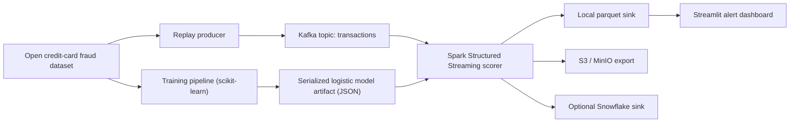

# Real-Time Fraud Detection System

An end-to-end portfolio project that simulates card transactions, streams them through Kafka, scores each event in Spark Structured Streaming, stores outputs in a data lake and optional Snowflake sink, and surfaces fraud alerts in a Streamlit dashboard.

## Why This Project Stands Out

- Streaming architecture with Kafka and Spark Structured Streaming
- ML model training plus production-friendly model serialization
- Real-time inference on every transaction
- S3-compatible storage via MinIO for local demos
- Optional Snowflake batch sink for warehouse analytics
- Dashboard-ready fraud alert stream for business monitoring

## Architecture



More detail lives in [`docs/architecture.md`](docs/architecture.md).

## Dataset

This repo uses the public credit-card fraud dataset mirrored by TensorFlow:

- TensorFlow tutorial: [Classification on imbalanced data](https://www.tensorflow.org/tutorials/structured_data/imbalanced_data)
- Direct CSV: [creditcard.csv](https://storage.googleapis.com/download.tensorflow.org/data/creditcard.csv)

The original dataset is the well-known ULB / Worldline fraud dataset popularized on Kaggle. Using TensorFlow's hosted copy makes the project reproducible without Kaggle API credentials.

## Tech Stack

- Python
- scikit-learn
- Kafka
- Spark Structured Streaming
- MinIO (S3-compatible object storage)
- Snowflake connector
- Streamlit

## Project Layout

```text
.
├── dashboard/
│   └── app.py
├── data/
│   ├── artifacts/
│   ├── outputs/
│   ├── processed/
│   └── raw/
├── docs/
│   └── architecture.md
├── infra/
│   └── docker-compose.yml
├── src/
│   └── fraud_detection/
└── tests/
```

## End-to-End Flow

1. `fraud-download` pulls the public dataset into `data/raw/`.
2. `fraud-train` builds engineered features, trains a weighted logistic regression model, chooses a fraud threshold, and writes:
   - `data/artifacts/logistic_fraud_model.json`
   - `data/artifacts/training_metrics.json`
   - `data/processed/streaming_seed.csv`
3. `fraud-produce` replays the holdout dataset into Kafka, with optional fraud oversampling for demo visibility.
4. `fraud-stream` reads Kafka in Spark Structured Streaming, scores each event, writes parquet micro-batches locally, exports to MinIO, and optionally loads batches into Snowflake.
5. `streamlit run dashboard/app.py` shows KPIs, recent alerts, and risk trends.

## Local Quickstart

Use Python 3.11 for this repo. PySpark `3.5.1` matches the Spark `3.5.x` runtime used here, and that PySpark release does not target Python 3.14.

Spark also requires Java at runtime. Apache Spark 3.5.1 supports Java 8, 11, and 17; for a new local setup on macOS, Java 17 is the safest choice.

### 1. Install dependencies

```bash
cp .env.example .env
python3.11 -m venv .venv
. .venv/bin/activate
pip install --upgrade pip
pip install -e .
```

### 2. Install Java 17

If `fraud-stream` fails with `Unable to locate a Java Runtime`, install Java 17 and expose it on your shell path:

```bash
brew install openjdk@17
export JAVA_HOME="$(brew --prefix openjdk@17)/libexec/openjdk.jdk/Contents/Home"
export PATH="$JAVA_HOME/bin:$PATH"
java -version
```

To make that persistent in `zsh`, add the two `export` lines above to `~/.zshrc` and open a new terminal.

The dashboard reads every parquet file by default. If you want to cap dashboard load time for a very large demo history, set `DASHBOARD_MAX_FILES` in `.env`.

### 3. Start infrastructure

```bash
docker compose -f infra/docker-compose.yml up -d
```

This starts:

- Kafka on `localhost:9092`
- MinIO API on `http://localhost:9000`
- MinIO console on `http://localhost:9001`

Spark Structured Streaming runs locally from your Python 3.11 virtualenv when you start `fraud-stream`, using the default `SPARK_MASTER=local[*]` setting from `.env`.

### 4. Download data and train the model

```bash
fraud-download
fraud-train
```

If you want counts for only the current run, clear old streaming outputs and checkpoints before restarting:

```bash
rm -rf data/outputs/checkpoints
rm -rf data/outputs/predictions/_spark_metadata data/outputs/alerts/_spark_metadata
rm -f data/outputs/predictions/*.parquet data/outputs/predictions/*.crc
rm -f data/outputs/alerts/*.parquet data/outputs/alerts/*.crc
```

### 5. Start the streaming scorer

```bash
fraud-stream
```

### 6. Start the transaction producer

Open another shell:

```bash
fraud-produce --rate 15 --fraud-boost 30
```

### 7. Launch the dashboard

Open a third shell:

```bash
streamlit run dashboard/app.py
```

## Snowflake Support

Set these values in `.env` to enable the optional warehouse sink:

- `SNOWFLAKE_ENABLED=true`
- `SNOWFLAKE_ACCOUNT`
- `SNOWFLAKE_USER`
- `SNOWFLAKE_PASSWORD`
- `SNOWFLAKE_WAREHOUSE`
- `SNOWFLAKE_DATABASE`
- `SNOWFLAKE_SCHEMA`
- `SNOWFLAKE_TABLE`

Spark still writes local parquet and MinIO outputs; Snowflake is an additional micro-batch export path.

## Design Choices

- The training pipeline stores the model as JSON instead of a pickle so Spark workers can load it without scikit-learn artifacts.
- The inference model is a weighted logistic regression because its coefficients can be applied consistently in streaming.
- The producer enriches each row with merchant metadata and controlled fraud oversampling so the dashboard is lively during demos.
- MinIO gives you a no-cloud local substitute for S3 while keeping the same object-storage mental model.
- Snowflake export is handled in micro-batches using the Python connector and `write_pandas`, which is practical for demo-scale streaming workloads.

## Commands

```bash
make setup
make infra-up
make download
make train
make stream
make produce
make dashboard
make test
```

## Validation

The included tests cover pure-Python feature engineering and model scoring logic:

```bash
python3 -m unittest discover -s tests -v
python3 -m compileall src dashboard tests
```
