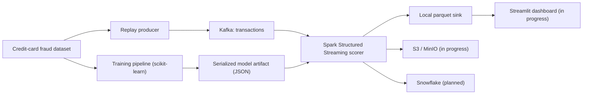

# Real-Time Fraud Detection System

An end-to-end Big Data Analytics project that streams card transactions through Kafka, scores each event in Spark Structured Streaming, and stores outputs in a data lake.

## Architecture



## Tech Stack
- Python 3.11
- scikit-learn
- Apache Kafka
- Apache Spark Structured Streaming
- MinIO (S3-compatible) & Snowflake connector
- Streamlit

## Current Project Status (~65% Completed)

| Layer | Status | Owner |
|---|---|---|
| Project Scaffolding & Setup | ✅ Completed | Nidhi Shekhawat |
| Configuration & Infrastructure (Docker Compose) | ✅ Completed | Nidhi Shekhawat |
| Dataset Pipeline & Download | ✅ Completed | Nidhi Shekhawat |
| Schema & Feature Engineering | ✅ Completed | Anukrati Chaturvedi |
| Offline Model Training & Evaluation | ✅ Completed | Anukrati Chaturvedi |
| Model Serialization & Scoring Engine | ✅ Completed | Anukrati Chaturvedi |
| Feature & Scoring Unit Tests | ✅ Completed | Monisha Badugu |
| Kafka Admin & Event Replay Producer | ✅ Completed | Hemanth Sai Somaraju |
| Spark Structured Streaming Engine | ✅ Completed | Hemanth Sai Somaraju |
| Real-time Scoring UDF & Alert Classification | ✅ Completed | Hemanth Sai Somaraju |
| Local Parquet Analytics Sink | ✅ Completed | Hemanth Sai Somaraju |
| Cloud Object Storage (MinIO / S3) Sink | 🔄 In Progress | Hemanth Sai Somaraju |
| Data Warehouse (Snowflake) Sink | 📋 Planned | Hemanth Sai Somaraju |
| Interactive Alert Dashboard (Streamlit) | 🔄 In Progress | Monisha Badugu |

## Team Contributions

- **Nidhi Shekhawat (Project Lead & Data Engineer)**: Project layout, environment configuration, Docker infrastructure setup (Kafka, MinIO), and dataset ingestion.
- **Anukrati Chaturvedi (ML Engineer)**: Feature engineering, offline model training with recall optimization (F-beta), evaluation metrics, and standalone scoring module.
- **Hemanth Sai Somaraju (Streaming Engineer)**: Kafka event replay producer with synthetic metadata, PySpark Structured Streaming real-time scoring engine, broadcast model UDF, and analytics parquet sinks.
- **Monisha Badugu (Frontend & Integration Engineer)**: Unit testing suite for feature extraction and inference scoring, architecture documentation, system flow design, and ongoing Streamlit dashboard integration.

## Local Quickstart

### 1. Setup Environment
```bash
cp .env.example .env
python3.11 -m venv .venv
source .venv/bin/activate
pip install --upgrade pip
pip install -e .
```

### 2. Launch Infrastructure
```bash
make infra-up
```

### 3. Download Data & Train Offline Model
```bash
fraud-download
fraud-train
```

### 4. Run Streaming Engine & Producer
In Terminal 1:
```bash
fraud-stream
```

In Terminal 2:
```bash
fraud-produce --rate 15 --fraud-boost 30
```

### 5. Run Unit Tests
```bash
make test
```
