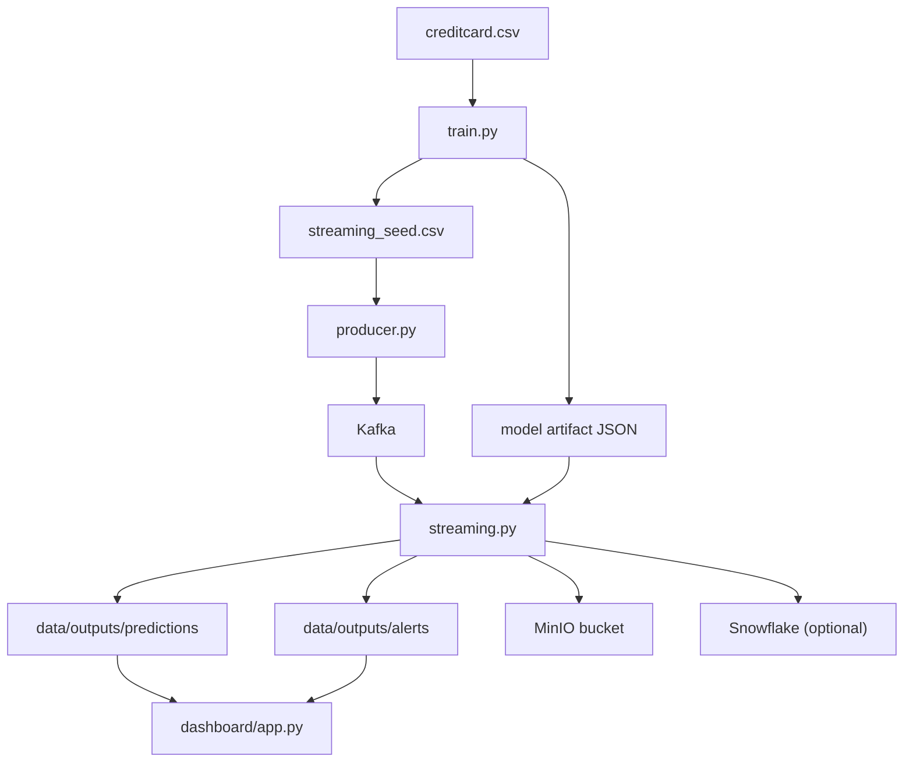

# Architecture Notes

## Streaming Topology

## Runtime Stages

### Offline training

- Download the fraud dataset.
- Split the data into train, validation, and holdout test sets.
- Engineer numeric features suitable for both offline and real-time scoring.
- Train a class-weighted logistic regression model.
- Tune a decision threshold on the validation set using an F-beta bias toward recall.
- Persist the model coefficients, scaling metadata, and threshold in JSON.

### Online scoring

- Replay holdout transactions through Kafka.
- Use Spark Structured Streaming to consume transactions in micro-batches.
- Apply the exact same feature engineering logic used during training.
- Score each row with a logistic function using the JSON artifact.
- Write scored transactions and high-risk alerts as parquet.
- Export each micro-batch to MinIO and optionally to Snowflake.

## Production-Friendly Details

- No pickled model dependency in streaming.
- Clear separation between training, replay, scoring, storage, and dashboard layers.
- Fraud oversampling is isolated to the replay producer, not the model itself.
- Object storage export is independent from dashboard serving.
- Snowflake is optional so the project runs locally without cloud credentials.

