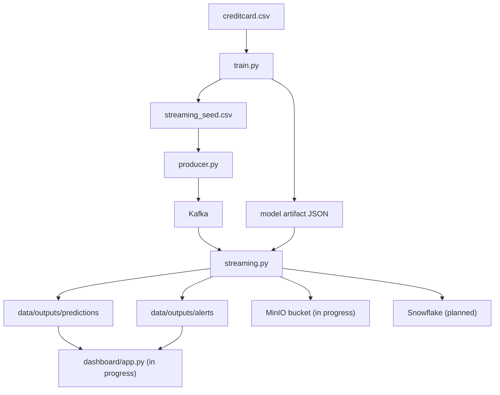

# Architecture Notes

## Streaming Topology

## Runtime Stages

### Offline training
- Download the fraud dataset.
- Split into train, validation, and holdout test sets.
- Engineer numeric features for both offline and real-time scoring.
- Train a class-weighted logistic regression model.
- Tune decision threshold on validation set using F-beta bias toward recall.
- Persist coefficients, scaling metadata, and threshold as JSON artifact.

### Online scoring
- Replay holdout transactions through Kafka.
- Spark Structured Streaming consumes transactions in micro-batches.
- Same feature engineering logic applied as during training.
- Score each row with logistic function from JSON artifact.
- Write scored transactions and high-risk alerts as parquet micro-batches.

## Production-Friendly Details
- No pickled model in streaming — JSON artifact only.
- Clear separation: training → replay → scoring → storage → dashboard.
- Fraud oversampling isolated to producer, not the model itself.
- Snowflake and S3 sinks are optional (in progress).
